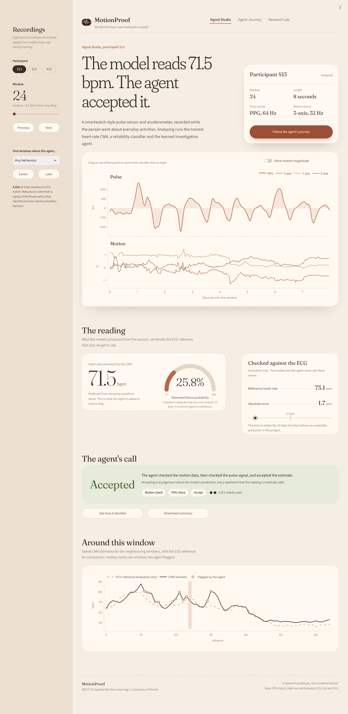
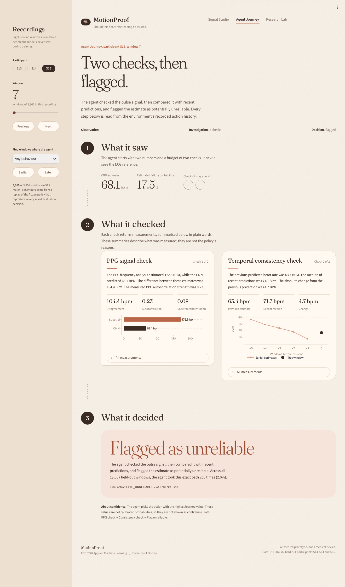
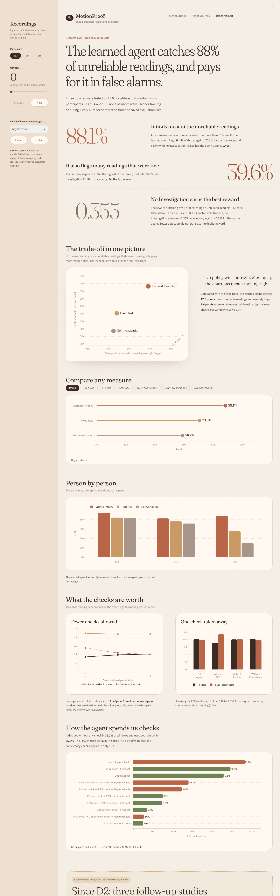
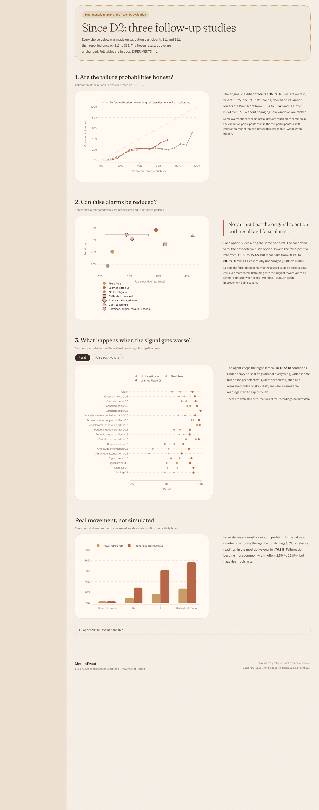

# MotionProof AI

**Adaptive agent investigation for reliable heart-rate estimation from wrist PPG**

EEE 6778 Applied Machine Learning II, University of Florida. Deliverable 4: extended evaluation, statistical analysis and reproducibility (November 2026). D4 builds on the D2 prototype and the D3 interface without retraining any model.

MotionProof AI estimates heart rate from a wrist-worn photoplethysmography (PPG) sensor and then asks a second question: **should this estimate be trusted?** A reliability classifier scores each prediction, and a learned investigation agent decides whether to accept it, flag it, or first spend a limited budget of checks on the pulse signal, the motion data or recent predictions.

This is a research prototype. It is not a medical device and makes no clinical claims.



## Contents

1. [Author](#author)
2. [Motivation and research question](#motivation-and-research-question)
3. [System architecture](#system-architecture)
4. [Streamlit application](#streamlit-application)
5. [Dataset and participant splits](#dataset-and-participant-splits)
6. [Installation](#installation)
7. [Launching the application](#launching-the-application)
8. [Results](#results)
9. [Reproducibility](#reproducibility)
10. [Project structure](#project-structure)
11. [Known limitations](#known-limitations)
12. [Responsible AI](#responsible-ai)
13. [Citation and licences](#citation-and-licences)

## Author

**Nitishwar Vasantha Kumar**  
M.S. Applied Data Science, University of Florida  
Email: supermanspider2511@gmail.com

## Motivation and research question

Wrist PPG heart-rate estimates degrade when the wearer moves. The sensor picks up motion artefacts, and an estimator can lock onto the step rate instead of the pulse. Most systems still report every estimate as if it were equally trustworthy.

MotionProof AI treats reliability as its own decision problem:

> Can a learned, budget-constrained investigation policy detect unreliable PPG heart-rate predictions better than fixed investigation rules or no investigation?

A prediction counts as **unreliable** when its absolute error against the ECG-derived reference exceeds **10 BPM**. "Detecting" means flagging it. The main trade-off is between **recall** (unreliable predictions that get flagged) and the **false-positive rate** (reliable predictions that get flagged anyway).

## System architecture

```text
 Wrist PPG (8 s, 64 Hz) + 3-axis accelerometer (8 s, 32 Hz)
        │
        ▼
 1. Heart-rate CNN ──────────────► predicted HR (BPM)
        │
        ▼
 2. Reliability features + nonlinear classifier ──► P(|error| > 10 BPM)
        │
        ▼
 3. Investigation environment (budget: 2 checks per window)
        │   CHECK_PPG · CHECK_MOTION · CHECK_CONSISTENCY
        ▼
 4. Fitted Q-learning agent ──► ACCEPT or FLAG_UNRELIABLE
```

The ECG reference heart rate is used only for training labels and evaluation. It is never an input to the CNN, the classifier features, the investigation tools or the agent.

### 1. Heart-rate CNN

`src/models/ppg_cnn.py`, checkpoint `checkpoints/ppg_cnn_best.pt`.

- A 1-D convolutional network on the 512-sample PPG window: four convolution blocks (32, 64, 128 and 128 channels) and a two-layer regression head.
- Trained on S1–S10; the checkpoint was selected on validation participants S11–S12 (best validation MAE 9.15 BPM).
- On the held-out test participants: **MAE 5.40 BPM, RMSE 7.93 BPM**, with 13.9% of windows above the 10 BPM threshold.

### 2. Reliability classifier

`src/evaluation/reliability_nonlinear.py`, checkpoint `checkpoints/reliability_classifier_nonlinear_full.joblib`.

- A scikit-learn `HistGradientBoostingClassifier` that predicts the probability that the CNN error exceeds 10 BPM.
- It uses 14 features computed from the signals and the CNN output: PPG amplitude and spectral statistics (dominant frequency, spectral concentration and entropy), accelerometer motion statistics, and the predicted heart rate.
- Trained on S1–S10. This probability is a failure estimate, **not** the agent's confidence.

### 3. Investigation environment and tools

`src/agents/investigation_environment.py` and `src/agents/*_investigation.py`.

Each window starts with the CNN estimate, the failure probability and a budget of two checks. Each check costs one unit and can run at most once.

| Action | What it measures |
|---|---|
| `CHECK_PPG` | Spectral heart-rate estimate, disagreement with the CNN, autocorrelation and spectral concentration |
| `CHECK_MOTION` | Acceleration-magnitude variation, range and dominant motion frequency |
| `CHECK_CONSISTENCY` | Previous CNN predictions (up to 5), their median, and the jump from the last one |
| `ACCEPT` / `FLAG_UNRELIABLE` | Final decision; ends the episode |

### 4. Fitted Q-learning agent and baselines

`src/agents/fitted_q_inference.py` (inference) and `src/agents/fitted_q_training.py` (training), checkpoint `checkpoints/learned_policy_fitted_q_full.pt`.

- **Learned policy.** Finite-horizon fitted Q-learning with one MLP per budget stage (3 stages, 64 hidden units), trained by backward induction on every investigation prefix of every S1–S10 window. The state has 28 features: the CNN estimate, the failure probability, the remaining budget and the results of completed checks. The agent picks the highest-valued valid action and may decide immediately without investigating.
- **Reward.** +2 for flagging an unreliable prediction, −1.5 for a false alarm, −2 for a missed failure, 0 for a correct accept, and −0.1 per check.
- **Fixed-rule baseline** (`src/agents/fixed_rule_policy.py`). Accept if the probability is below 0.30. Otherwise run `CHECK_PPG`, then a motion or consistency check depending on whether CNN–spectral disagreement reaches 15 BPM. Flag if the probability is at least 0.60 or the disagreement is at least 15 BPM.
- **No-investigation baseline.** Flag when the failure probability is at least 0.5.

## Streamlit application

The D3 application (`app_d3.py`, modules in `ui/`) has three workspaces. It uses the same inference pipeline as the D2 prototype (`app.py`, kept unchanged).

| Workspace | Purpose |
|---|---|
| **Signal Studio** | Browse participants and windows. View PPG and accelerometer signals on a shared time axis (zooming one panel zooms both). Run the full pipeline, see the CNN estimate and failure probability next to the evaluation-only ECG reference and error, read the agent's decision, and download a Markdown summary. |
| **Agent Journey** | Follow the agent's recorded path as three chapters: what it saw, what it checked, what it decided. Each check shows its measurements with factual explanations. Immediate decisions are shown as "no checks were run". |
| **Research Lab** | The frozen D2 held-out evaluation, followed by a separately labelled "Since D2" section with the calibration, false-positive and robustness studies. |

The sidebar can jump to windows by agent behaviour (for example "uses CHECK_CONSISTENCY"). Behaviours come from `results/demo/learned_agent_traces.csv`, a replay of the frozen policy that reproduces all 13,007 saved test decisions. Deep links such as `?s=15&w=7&page=journey` open a specific window.

| Agent Journey | Research Lab |
|---|---|
|  |  |

## Dataset and participant splits

**PPG-DaLiA** (Reiss, Indlekofer and Schmidt, 2019): 15 participants wearing a wrist device (Empatica E4) and a chest ECG during everyday activities. Source: <https://archive.ics.uci.edu/dataset/495/ppg+dalia>. Licence: CC BY 4.0.

Signals are cut into 8-second windows with a 2-second stride: 512 PPG samples, 256 × 3 accelerometer samples, and one ECG-derived reference heart rate per window.

| Split | Participants | Windows | Used for |
|---|---|---|---|
| Training | S1–S10 | 43,215 | CNN, reliability classifier, fitted Q policy |
| Validation | S11, S12 | 8,475 | Model selection, calibration fitting, D3 and D4 experiment selection |
| Held-out test | S13, S14, S15 | 13,007 | Reporting only; never used for tuning or selection |

**Not included in this repository.** The raw recordings (`data/raw/PPG_FieldStudy/`) and the processed participant windows (`data/processed/val/*.npz`, `data/processed/test/*.npz`) are not included. To rebuild them, download PPG-DaLiA and run `notebooks/setup.ipynb`, which creates the windows with `src/preprocessing/`.

**What works without them:** the Research Lab, the frozen-artifact check and most tests. Signal Studio and Agent Journey show a message explaining which file is missing. Derived per-window outputs (model predictions, probabilities and reference heart rates) are included where the evaluation and experiment scripts need them.

## Installation

Python 3.12 is recommended; the checkpoints were verified with it. `requirements.txt` pins exact versions, and scikit-learn must stay at 1.4.0 to load the reliability classifier.

```bash
git clone https://github.com/nitshvrn123/MotionProof-AI.git
cd MotionProof-AI
python3.12 -m venv .venv
source .venv/bin/activate            # Windows: .venv\Scripts\Activate.ps1
python -m pip install -r requirements.txt
python -m src.experiments.verify_frozen
python -m pytest -q
```

Everything runs on CPU.

## Launching the application

```bash
streamlit run app_d3.py
```

Place `data/processed/test/S13.npz`, `S14.npz` and `S15.npz` in the project to enable Signal Studio and Agent Journey. The D2 prototype is still available with `streamlit run app.py`.

## Results

All test numbers are on the 13,007 held-out windows from S13–S15, with "unreliable" meaning CNN error above 10 BPM (13.9% of windows).

### Frozen D2 evaluation

These are the official held-out results from D2 (`results/metrics/final_test/`). They are frozen: their SHA-256 hashes are recorded in `configs/frozen_artifacts.json` and checked by the test suite.

| Policy | Accuracy | Precision | Recall | F1 | False-positive rate | Checks / window | Avg reward |
|---|---|---|---|---|---|---|---|
| Fixed rule | 68.3% | 26.1% | 70.3% | 0.381 | 32.0% | 1.04 | −0.404 |
| **Learned fitted Q** | 64.2% | 26.4% | **88.1%** | **0.406** | 39.6% | 0.96 | −0.396 |
| No investigation | 67.4% | 23.3% | 58.7% | 0.333 | 31.2% | 0.00 | −0.355 |

**Reading these results:**

- **Highest recall and F1.** The learned agent flags 88.1% of unreliable predictions, against 70.3% for the fixed rule.
- **Not better on every metric.** It also has the highest false-positive rate (39.6%) and the lowest accuracy. The no-investigation baseline has the best average reward under the project's reward function.
- **The fair summary** is improved detection of unreliable predictions, at the cost of more false alarms.

Per participant, the learned agent's recall is 94.2% (S13), 82.6% (S14) and 88.2% (S15).

### Post-D2 experiments (D3, experimental)

These studies are separate from the frozen results. Every choice was made on validation participants S11–S12, and the results were reported once on S13–S15. Full tables and methods are in [`docs/EXPERIMENTS.md`](docs/EXPERIMENTS.md).

**1. Calibration of the reliability classifier.** Platt scaling and isotonic regression were fitted on S11–S12, and Platt was selected by leave-one-participant-out Brier score.

| Held-out test | ECE | Brier | ROC AUC | Mean predicted | Observed |
|---|---|---|---|---|---|
| Original | 0.224 | 0.194 | 0.731 | 36.3% | 13.9% |
| Platt (selected) | 0.156 | 0.140 | 0.731 | 29.5% | 13.9% |
| Isotonic | 0.161 | 0.142 | 0.731 | 30.0% | 13.9% |

The original probabilities overestimate failure. Calibration helps, but some overconfidence remains, because failures are far more common in the validation participants (33.7%) than in the test participants (13.9%).

**2. False-positive reduction.** The candidates were:

- probability thresholds;
- a calibrated veto, which keeps an agent FLAG only if the calibrated probability is at least τ;
- a cost-based rule;
- 18 policies retrained with alternative rewards (6 settings × 3 seeds).

The selection rule, fixed in advance, was the lowest validation false-positive rate with recall no more than 5 points below the original agent.

- **No variant beat the original agent on both recall and false-positive rate**, on validation or test.
- The best deterministic option, the calibrated veto at τ = 0.26, lowers the test false-positive rate from 39.6% to **35.4%**, but recall falls from 88.1% to **80.9%** (F1 0.404 vs 0.406). It is a different operating point, not an improvement.
- Raising the false-alarm penalty in the reward cuts false positives but costs more recall.
- Retraining with the original reward varies by several points between seeds (validation false-positive rate 32.8–37.6%), which is as large as the effects being sought.

**3. Robustness.**

*Synthetic perturbations.* 18 conditions were applied to copies of the real test recordings: PPG noise, motion artefacts and signal degradation. The full pipeline was re-run for each one.

- The learned agent has the **highest recall of the three policies in all 18 conditions**.
- Under heavy noise or strong motion artefacts its false-positive rate rises to 85–95% because it flags almost everything.
- Slow baseline drift and a weakened pulse reduce recall to 72–75%.
- A strong 2 Hz step-rate artefact drops the classifier's AUC to 0.41.

*Natural motion.* Clean test windows were grouped by measured accelerometer motion; these are not activity labels. The agent's false-positive rate rises from 3.0% in the calmest quarter of windows to 76.8% in the most active quarter.



### D4 extended evaluation

No training. Choices were made on validation participants S11–S12 only, and the frozen D2/D3 results are unchanged. Notebook: [`notebooks/D4_Extended_Evaluation.ipynb`](notebooks/D4_Extended_Evaluation.ipynb).

**1. Motion-aware thresholds: not supported.** One veto threshold per motion level (low / moderate / high, tertiles of validation motion) was compared with the frozen agent and the D3 global veto. The success criteria were written in `configs/experiments/d4_motion_thresholds.json` before running.

- It passed the validation criterion (C1), but failed the leave-one-participant-out check (C2) in both folds and failed the test confirmation (C3). In that check the motion edges and veto thresholds were re-selected on one validation participant (S11 or S12) and evaluated on the other; test participants were not used, and no model was retrained.
- On test it lowers the false-positive rate by only 0.2 points versus the global veto (35.2% vs 35.4%), and recall drops to 79.9%.
- It gets its gains by removing low-motion flags: low-motion recall falls from 72.6% to 22.8%.

**2. Participant-wise results.** The agent has the highest recall for every test participant: S13 94.2%, S14 82.6%, S15 88.2%. Its gain over the fixed rule ranges from 6.2 to 32.9 points, and S14 has the highest false-positive rate (48.2%).

**3. Uncertainty.** A moving-block bootstrap (blocks of 30 windows, resampled within each participant, 2,000 resamples) gives these agent − fixed rule differences:

- recall **+17.8 points** (95% CI 14.9 to 20.7);
- false-positive rate +7.6 points (6.2 to 9.0);
- F1 +2.5 points (1.2 to 3.8).

The result is stable across block lengths of 15–120 windows. With three participants, these intervals describe these recordings, not the population.

**4. Failure cases.**

- Within high-motion windows the classifier is close to chance (AUC 0.53, versus 0.89 in low motion), which is why no threshold fixes high-motion false alarms.
- Half of false alarms are flagged without any check.
- Compared with the probability-only rule, investigations caught 577 extra failures and avoided 637 false alarms, but raised 1,580 false alarms and caused 45 misses.

**5. Usability study materials.** `docs/usability/` holds the protocol, tasks and questionnaire for an exploratory 3–5 person study. Score responses with `python -m src.experiments.score_usability`.

## Reproducibility

Details are in [`docs/REPRODUCIBILITY.md`](docs/REPRODUCIBILITY.md): environment, splits, seeds, checkpoint hashes and known nondeterminism.

```bash
python -m src.experiments.verify_frozen          # frozen D2 checkpoints and results unchanged
python -m pytest -q                              # automated tests
python -m src.evaluation.build_agent_traces      # app trace cache (needs test recordings)
python -m src.experiments.run_calibration        # D3 calibration study
python -m src.experiments.train_reward_variants  # D3 reward variants (18 policies)
python -m src.experiments.run_fp_reduction       # D3 false-positive study (needs val/test recordings)
python -m src.experiments.run_robustness         # D3 robustness study (needs test recordings)
python -m src.experiments.run_motion_thresholds    # D4 motion-aware thresholds (needs val/test recordings)
python -m src.experiments.run_participant_analysis # D4 participant-wise results
python -m src.experiments.run_bootstrap            # D4 block-bootstrap intervals
python -m src.experiments.run_failure_cases        # D4 failure cases (needs test recordings)
bash scripts/reproduce_experiments.sh            # all of the above in order
```

The notebooks need Jupyter, which is not in `requirements.txt` because the app, scripts and tests do not use it: `python -m pip install jupyterlab ipykernel`.

- **Configuration tracking.** Each experiment reads a JSON config in `configs/experiments/` and writes a `manifest.json` with input hashes and package versions.
- **Separate experimental checkpoints.** Experimental checkpoints live in `checkpoints/experimental/` and never replace the production models.
- **Training data.** Policy training reads the compressed state table `results/metrics/policy_investigation_states_full.csv.gz` (S1–S10).
- **Retraining is close, not exact.** Retraining the production policy on CPU reproduces its training closely but not bit-for-bit: 91.2% of test decisions agree.

## Project structure

```text
MotionProof-AI/
├── app_d3.py                    D3 Streamlit application
├── app.py                       D2 prototype (unchanged pipeline)
├── ui/                          D3 interface: theme, components, charts, pipeline, helpers
├── src/
│   ├── preprocessing/           loading, windowing, features
│   ├── models/                  PPG CNN and datasets
│   ├── agents/                  environment, tools, policies, fitted Q inference and training
│   ├── evaluation/              D2 evaluation scripts, app trace builder
│   └── experiments/             D3 calibration, false-positive and robustness studies; D4 motion-aware
│                                thresholds, participant analysis, bootstrap, failure cases, usability scoring
├── checkpoints/                 three production models
│   └── experimental/            D3 calibrators and retrained policies
├── configs/                     experiment configs (D3 and D4), frozen-artifact hashes
├── results/
│   ├── metrics/final_test/      frozen D2 held-out evaluation
│   ├── demo/                    verified agent traces for the app
│   └── experiments/             D3 study outputs (phase1–3) and D4 outputs (d4_*)
├── docs/                        EXPERIMENTS.md, REPRODUCIBILITY.md, screenshots, usability/ (D4 study materials)
├── notebooks/                   setup, D2, D3 and D4 notebooks
├── scripts/                     reproduce_experiments.sh
├── static/fonts/                bundled interface fonts (SIL OFL)
└── tests/
```

## Known limitations

- **Few participants.** Only three held-out participants and two validation participants. Results vary noticeably between participants.
- **False positives remain high.** The learned agent's false-positive rate, especially during movement, is its main weakness, and none of the tested alternatives, including the D4 motion-aware thresholds, removed it without losing recall.
- **Calibration under shift.** Calibration fitted on S11–S12 does not fully transfer to S13–S15 because failure rates differ between participants.
- **Training nondeterminism.** Retrained policies vary by several points between seeds and hardware.
- **Simplified perturbations.** The synthetic perturbations are simplified stand-ins for real artefacts. Activity-level analysis was not possible because activity labels are only in the raw recordings.
- **One reward choice.** Rewards follow one modelling choice; other cost structures would give different "best" policies.

## Responsible AI

- **Not clinical.** This is a research prototype and not for diagnosis or clinical decisions. Accepting a prediction is a judgement about the model's output, not a statement that a reading is medically safe.
- **No leakage.** ECG reference values never enter inference. The app shows them only as clearly labelled evaluation data.
- **Transparency.** The interface shows the agent's actual recorded actions and the measurements it received. Explanations describe measurements and are not presented as the policy's reasons. Uncalibrated Q-values are not shown as confidence.
- **Honest reporting.** Negative and mixed results, such as the higher false-positive rate and the absence of a dominant false-positive fix, are reported alongside positive ones.
- **Privacy.** Only the public PPG-DaLiA dataset is used. Participant recordings are not redistributed in this repository.

## Citation and licences

Dataset: A. Reiss, I. Indlekofer, and P. Schmidt, "PPG-DaLiA," UCI Machine Learning Repository, 2019, doi:10.24432/C53890. Licensed under CC BY 4.0. Derived files in `results/` (model outputs, probabilities, reference heart rates and training states) are adaptations of this dataset and are shared under the same attribution requirement.

Related paper: A. Reiss, I. Indlekofer, P. Schmidt, and K. Van Laerhoven, "Deep PPG: Large-scale heart rate estimation with convolutional neural networks," *Sensors*, 19(14), 2019.

Fonts: Fraunces and Figtree, SIL Open Font License (`static/fonts/`).
